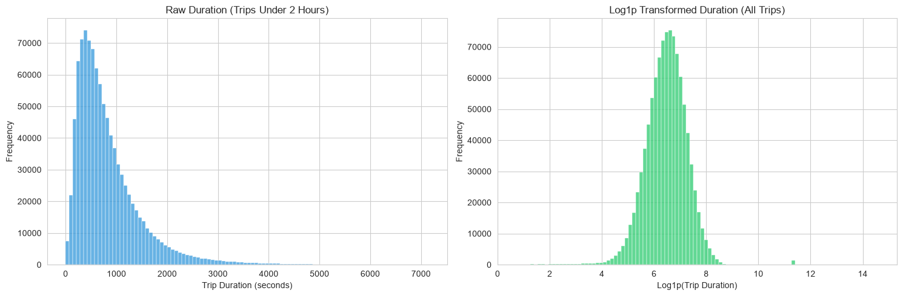
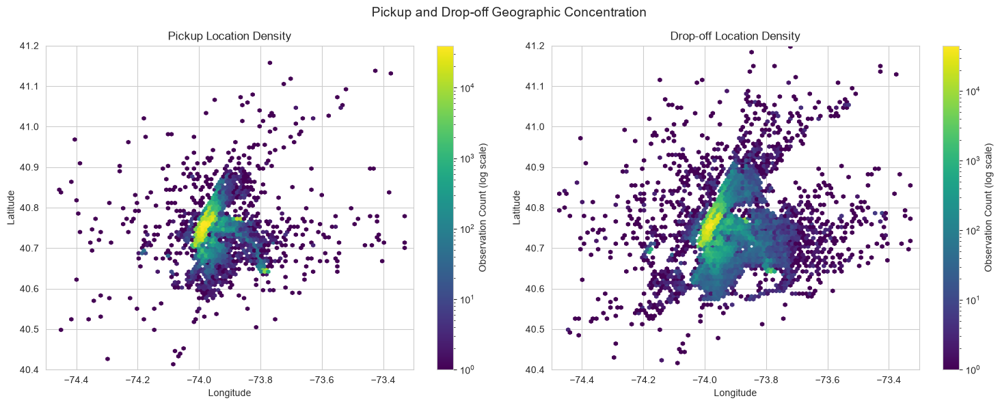
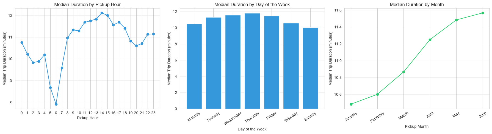

# NYC Taxi Trip Duration Prediction

A machine learning project that predicts the duration of New York City taxi trips using **Ridge Regression** and engineered geographic, temporal, and categorical features.


**Status:** Completed

## Project Structure

```text
taxi-trip-duration/
│
├── assets/
│   ├── nyc-taxi-banner.jpg
│   ├── target_distribution.png
│   ├── pickup_dropoff_density.png
│   └── temporal_patterns.png
│
├── dataset/
│   ├── split/
│   │   ├── train.csv
│   │   ├── val.csv
│   │   └── test.csv
│   │
│   └── split_sample/
│       ├── train.csv
│       ├── val.csv
│       └── test.csv
│
├── model/
│   └── ridge_model.pkl
│
├── notebook/
│   └── EDA.ipynb
│
├── report/
│   └── NYC_Taxi_Trip_Duration_Report.pdf
│
├── results/
│   └── results.md
│
├── src/
│   └── taxi_trip_duration/
│       ├── __init__.py
│       │
│       ├── manipulation/
│       │   ├── __init__.py
│       │   ├── data_helper.py
│       │   └── feature_engineering.py
│       │
│       ├── model_building/
│       │   ├── __init__.py
│       │   ├── baseline.py
│       │   ├── explore.py
│       │   └── final_pipeline.py
│       │
│       ├── model_testing/
│       │   ├── __init__.py
│       │   └── test.py
│       │
│       └── visualization/
│           ├── __init__.py
│           ├── plotting.py
│           └── summaries.py
│
├── .gitignore
├── pyproject.toml
└── README.md
```

## Overview

The objective of this project is to predict the total duration of a taxi trip using its pickup timestamp, pickup and drop-off coordinates, passenger information, and other available trip attributes.

The project follows a machine learning workflow that includes exploratory data analysis (EDA), feature engineering, preprocessing, baseline modeling, feature experiments, final model training, and test-set evaluation.

The prediction target, `trip_duration`, is measured in seconds. A `log1p` transformation is applied during model training to reduce the influence of large duration values and provide an alternative target scale.

The final model uses Ridge Regression with `alpha=1.0`, implemented in a Scikit-learn pipeline.

## Project Report

The project report summarizes the main EDA findings, engineered features, modeling experiments, and final performance results.

[**View the Project Report (PDF)**](report/NYC_Taxi_Trip_Duration_Report.pdf)

## Exploratory Data Analysis

The EDA examines the original dataset, investigates potential data-quality issues, and explores the distributions and relationships of the engineered features.

### Target Distribution

The target is examined on its original scale and after applying `log1p`. The transformation compresses large duration values, making the distribution easier to inspect.



### Geographic Distribution

Pickup and drop-off coordinates are analyzed to investigate geographic concentration and identify unusual locations within and outside the selected NYC plotting region.



### Temporal Patterns

Trip-duration distributions are compared across pickup hours, days of the week, months, weekdays and weekends, and the defined rush-hour periods.



### Key Findings

- **Distance and duration:** Haversine and Manhattan-style distances show positive relationships with trip duration, although trips with similar distances can have substantially different durations.
- **Skewed distributions:** Both geographic distance features are strongly right-skewed. Applying `log1p` reduces their observed skewness.
- **Temporal variation:** Trip-duration distributions vary across pickup hours, days of the week, and the months represented in the training data.
- **Geographic concentration:** Pickup and drop-off locations are concentrated within a relatively narrow geographic region.
- **Potential data-quality issues:** The training data contains 4,085 trips with identical recorded pickup and drop-off coordinates and extreme geographic distances, including a maximum Haversine distance of approximately 1,240.909 km.
- **Categorical sparsity:** Combined pickup–drop-off grid categories are considerably sparser than individual pickup and drop-off grid categories.

These findings describe patterns in the training data. They do not establish causation, prove that a feature improves prediction, or justify automatically removing unusual observations.

For the complete analysis, see [`notebook/EDA.ipynb`](notebook/EDA.ipynb).

## Feature Engineering

The project derives additional representations from the original trip attributes.

| Feature Group | Description |
|---|---|
| Temporal features | Extracts pickup hour, day of the week, month, and day of the year. |
| Haversine distance | Estimates great-circle distance between pickup and drop-off coordinates. |
| Manhattan-style distance | Approximates endpoint separation using north–south and east–west components. |
| Pickup bearing | Represents the initial geographic direction from pickup to drop-off. |
| Airport proximity | Calculates distances from pickup and drop-off coordinates to JFK, LaGuardia, and Newark reference points. |
| Rush-hour interactions | Combines a rush-hour indicator with geographic distance features. |
| Spatial and day–hour categories | Represents grid locations, pickup–drop-off combinations, and recurring weekly time slots. |
| Cyclical time features | Uses sine and cosine encodings for pickup hour and day of the week. |
| Distance relationship features | Calculates the ratio and difference between Manhattan-style and Haversine distances. |
| Log transformations | Applies `log1p` to the target and selected geographic distance features. |

These transformations provide alternative representations of the available information. Their predictive value is evaluated through validation experiments rather than assumed from the EDA alone.

## Modeling Approach

The modeling workflow consists of three stages.

### 1. Baseline Modeling

A Ridge Regression baseline establishes an initial benchmark using the original features without the additional engineered geographic distance features. `StandardScaler` and `MinMaxScaler` are compared, with `StandardScaler` achieving the better validation result.

### 2. Feature Experiments

Different feature configurations are evaluated to investigate the contribution of geographic distances, pickup bearing, airport proximity, rush-hour interactions, spatial categories, logarithmic distances, cyclical time encodings, and distance relationship features.

Spatial grid precision is also tested to evaluate the effect of geographic detail on model generalization.

### 3. Final Model

The selected configuration uses Ridge Regression with `alpha=1.0`, numerical scaling through `StandardScaler`, and categorical encoding through `OneHotEncoder`.

The preprocessing transformations and estimator are combined in a Scikit-learn pipeline and saved to `model/ridge_model.pkl`.

The validation split is used for model selection, while the test split is reserved for final evaluation.

## Model Results

The reported experiments produced the following R² scores.

| Model | Training R² | Validation R² | Test R² |
|---|---:|---:|---:|
| Baseline Ridge with `StandardScaler` | 0.06436 | 0.06645 | — |
| Final feature configuration | 0.72825 | 0.71223 | 0.71629 |

The final configuration substantially improves upon the baseline. Distance features, spatial categories, and log-transformed distances account for the major improvements across the reported experiments. Distance relationship features provide a smaller additional improvement.

Grid precision 2 achieves the highest validation R² among the tested precision settings. Higher precision increases training performance but reduces validation performance, indicating weaker generalization.

**Final reported test R²: 0.71629**

All reported R² scores were calculated against `log1p_trip_duration`, the log-transformed target. They therefore describe performance on the transformed target scale rather than directly measuring prediction errors in seconds.

Detailed experiment results are documented in [`results/results.md`](results/results.md).

## Technologies

- **Python** — Core programming language.
- **pandas** — Data manipulation and analysis.
- **NumPy** — Numerical operations and feature calculations.
- **Matplotlib and Seaborn** — Exploratory data visualization.
- **Scikit-learn** — Preprocessing, Ridge Regression, pipelines, and evaluation.
- **Joblib** — Saving and loading the trained model.
- **Jupyter Notebook** — Exploratory analysis.
- **uv** — Dependency and environment management.

## Installation and Setup

### Requirements

- Python 3.13 or later.
- [uv](https://docs.astral.sh/uv/) for dependency management.

### 1. Clone the Repository

```bash
git clone <your-repository-url>
cd taxi-trip-duration
```

Replace `<your-repository-url>` with the actual repository URL.

### 2. Install Dependencies

```bash
uv sync
```

### 3. Prepare the Datasets

Place the provided CSV files in `dataset/split/` and `dataset/split_sample/` according to the project structure above.

The project uses the prepared datasets rather than downloading a separate dataset. The CSV files are excluded by the current `.gitignore` configuration, so they may need to be obtained separately when setting up the project on another machine.

## Running the Project

Run these commands from the project root.

### Open the EDA Notebook

```bash
uv run jupyter notebook notebook/EDA.ipynb
```

### Run the Baseline Model

```bash
uv run python -m taxi_trip_duration.model_building.baseline
```

### Run Feature Experiments

```bash
uv run python -m taxi_trip_duration.model_building.explore
```

### Train and Save the Final Model

```bash
uv run python -m taxi_trip_duration.model_building.final_pipeline
```

The fitted pipeline is saved to `model/ridge_model.pkl`.

### Evaluate the Test Split

```bash
uv run python -m taxi_trip_duration.model_testing.test
```

The evaluation script loads the saved model, applies the corresponding feature-engineering steps, generates predictions, and reports the test R² score on the log-transformed target.

## Limitations

- Geographic distances estimate endpoint separation and do not represent actual road routes or traffic conditions.
- Extreme distances and identical pickup–drop-off coordinates warrant investigation; they are not automatically invalid based on their appearance alone.
- High-cardinality spatial categories can create sparsity and overfitting risks.
- The reported R² scores use the log-transformed target and are not direct measures of prediction error in seconds.
- Model performance may change when the data splits, feature configuration, or preprocessing steps change.

## Author

**Mohamed Elsayed**  
Engineering Student, Tanta University
